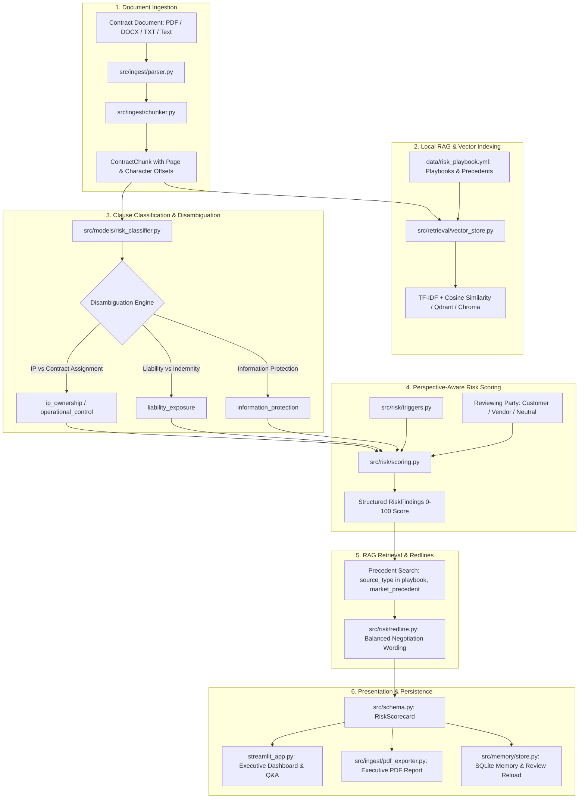

# LegalEagle System Architecture Specification

## 1. System Overview

LegalEagle is an explainable, retrieval-augmented contract risk detection agent designed as an academic research prototype and portfolio system. It accepts contracts in PDF, DOCX, TXT, or raw text format, segments them into reviewable clauses, identifies high-risk provisions using a perspective-aware risk scoring engine, retrieves market-standard negotiation precedents, and generates balanced contractual redlines.

---

## 2. End-to-End Pipeline Architecture

---

## 3. Core Component Specifications

### 3.1 Document Ingestion & Chunking (`src/ingest/`)
- **Parsers:**
  - `PyMuPDF (fitz)` extracts text and preserves page boundaries from PDF documents.
  - `python-docx` parses DOCX paragraphs, styles, and section headers.
  - Native UTF-8 TXT reader with form-feed page splitting.
- **Chunking Algorithm:**
  - Clause-boundary detection using legal heading regex (`\d+\.\s+[A-Z...]`) and all-caps titles.
  - Preserves exact page numbers, start character offsets, and end character offsets for precise auditability.
  - Windows max chunk size: 1,800 characters with 180-character overlap.

### 3.2 Clause Classification Engine (`src/models/risk_classifier.py`)
- Covers 13 focused CUAD categories:
  `termination`, `assignment`, `ip assignment`, `indemnification`, `limitation of liability`, `confidentiality`, `exclusivity`, `non-compete / non-solicit`, `governing law`, `change of control`, `most favored nation`, `audit rights`, `revenue / payment obligations`.
- **Contextual Disambiguation:**
  - **IP Ownership vs Agreement Assignment:** Phrases containing deliverables, inventions, copyright, patent, custom code, or work product are routed strictly to `ip assignment` (categorized as `ip_ownership`), preventing spurious contract assignment redlines.
  - **Confidentiality:** Mapped to `information_protection` rather than IP risk.
  - **Limitation of Liability vs Indemnity:** Differentiates liability caps containing indemnification carveouts from standalone defense/indemnification obligations.
  - **Non-Compete vs Termination:** Prevents incidental temporal markers like "following termination" from overriding non-compete provisions.

### 3.3 Explainable Risk Scoring Engine (`src/risk/scoring.py`)
- Evaluates risk on a transparent **0–100 scale** anchored across four tiers:
  - `Low`: 0–39
  - `Medium`: 40–69
  - `High`: 70–87
  - `Critical`: 88–100
- **Perspective-Aware Calibration:**
  - **Customer Perspective:** Severe penalties for uncapped customer liability, nominal vendor caps ($50), unilateral immediate termination, 5-year non-competes, and work product forfeiture.
  - **Vendor Perspective:** Recognizes protective vendor terms as low operational risk while noting potential commercial negotiation friction.
  - **Neutral Perspective:** Evaluates overall contractual asymmetry and deal balance.
- **Overall Aggregation Strategy:**
  - Highest-severity finding sets an immutable floor (a Critical finding enforces an overall score floor of 78, guaranteeing fatal liability terms are never diluted by benign clauses).
  - Rank-decayed weighted averaging of top findings prevents score runaway.
  - Omission penalty for missing essential governance provisions (up to +12 points).

### 3.4 Local RAG Architecture (`src/retrieval/vector_store.py`)
- **Strict Provenance Separation:**
  - `playbook`: Verified negotiation playbooks with guidance.
  - `market_precedent`: Standard market benchmarks and precedent wording.
  - `uploaded_contract`: Chunks from the active contract under review.
  - `reviewer_feedback`: Historical annotations from reviewers.
- **Circular Evidence Prevention:**
  - Precedent retrieval strictly queries external sources (`source_types=["playbook", "market_precedent"]`).
  - Uploaded contract chunks are never returned as independent market-standard benchmarks.

### 3.5 Grounded Question-Answering (`src/agent/conversation.py`)
- Scoped directly to the active contract's chunks.
- Anti-hallucination guardrail: explicitly discloses when a term or concept is absent from the contract rather than inventing missing clauses.
- Incorporates session chat history and party memory.

### 3.6 Memory Store (`src/memory/store.py`)
- SQLite database (`data/memory/legaleagle.sqlite3`).
- Tracks contract audit history, full JSON payloads, reviewer verdicts (`accepted`, `rejected`, `needs_review`), and party memory summaries.
- One-click past review reloading into active session state.

